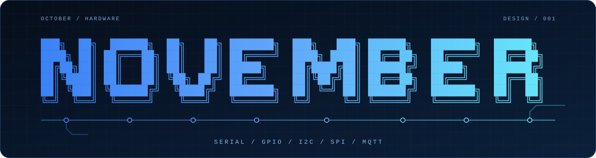

<div align="center">



<h1>November</h1>

<p><strong>An agentic harness for hardware.</strong><br>
Let an AI agent read sensors, switch things on and off, and talk to small boards, with safety checks it cannot get around.</p>

<p>
<a href="LICENSE"></a>

<a href="https://github.com/october-dev/november/actions/workflows/ci.yml"></a>
</p>

<p><a href="https://www.november.bot/">Website</a> · <a href="docs/support-matrix.md">Supported hardware</a> · <a href="docs/release-gates.md">Release gates</a> · <a href="docs/threat-model.md">Threat model</a> · <a href="CONTRIBUTING.md">Contributing</a></p>

</div>

---

> [!IMPORTANT]
> **November is in development.** Nothing is published to install yet. Most of the features below are **planned**, not finished. You can build the code from source (see [Development](#development)), but today it only checks its own setup and lists pretend devices. It does not control real hardware yet.

## At a glance

| | |
| --- | --- |
| **What it is** | Software that lets an AI agent work with physical devices: sensors, lights, buttons and small boards. |
| **Main board** | Raspberry Pi 4 (a small, cheap Linux computer). |
| **Small boards** | Raspberry Pi Pico first. Arduino, ESP32 and STM32 are possible later. |
| **Ways to connect** | Serial, GPIO, I2C, SPI and MQTT (explained [below](#words-used-in-this-readme)). All planned. |
| **Two ways to run** | In a terminal while you build a device, then as a background service on the finished device. Same code, stricter rules. |
| **Accounts** | No October account needed. You pick your AI model provider. |
| **Status** | In development. No release yet. Not for unattended or safety-critical use. |
| **License** | [Apache 2.0](LICENSE) |

## What is this?

AI agents are good at reading text and running commands on a computer. They have no safe way to touch the physical world. November is being built to give them one.

With November, an agent can be given tools to read a sensor, turn a pin on or off, or send a message to a small board. Every request the agent makes goes through a permission check. That check runs outside the AI model, so the model cannot talk its way past it. Every action is logged. If November is not sure whether something happened, it says so and does not just try again.

You use November in two stages:

1. **While building a device.** You work in a terminal on your computer or on the board itself. The agent helps you test sensors and outputs.
2. **On the finished device.** November runs quietly in the background as a service. It uses the same code but with tighter permissions and no coding tools.

## What you can do with it

These are the kinds of jobs November is meant for. They are **planned**: none of them work on real hardware yet.

| Example | What happens |
| --- | --- |
| **Read a temperature sensor** | The agent asks for a reading from a BME280 sensor (a small temperature, humidity and pressure sensor) and gets back a number, or a clear "no fresh reading". |
| **Turn on an LED** | The agent asks to switch on an LED for a few seconds. November checks the request is allowed and within limits. The board itself makes sure it turns off again. |
| **Read a button** | The agent can see whether a button is pressed. It cannot change it. |
| **Talk to an Arduino, ESP32 or Pico** | November sends commands to a small board plugged in over USB and waits for its reply. The Pico comes first; Arduino, ESP32 and STM32 boards are possible later if they use the same message format. |
| **Send readings to other systems** | November publishes sensor readings over MQTT so other apps can use them. |
| **Practise without hardware** | Simulated (pretend) devices let you test everything on a laptop first. A first list of these exists today. |

Things like pumps, motors and mains-powered devices show why the safety rules matter, but they are **not** part of the first version.

## Words used in this README

| Word | Plain meaning |
| --- | --- |
| **Agent** | An AI model that can take actions using tools, not just chat. |
| **Harness** | The software around an agent that gives it tools and sets its limits. |
| **GPIO** | The metal pins on a board like the Raspberry Pi. Software can turn them on or off, or read whether something (like a button) is on or off. |
| **I2C / SPI** | Two common ways for a board to talk to small chips such as sensors, using a few wires. |
| **Serial** | A simple way for two devices to send messages to each other, here over a USB cable. |
| **MQTT** | A lightweight way for devices to send messages to each other over a network, through a central "broker". |
| **Microcontroller** | A tiny, simple computer on one chip, such as a Pico, Arduino or ESP32. It runs one small program. |
| **Firmware** | The small program that runs on a microcontroller. |
| **Watchdog** | A timer that resets or shuts off something if the controlling software stops checking in. |
| **Emergency stop (e-stop)** | A way to cut power or stop a device straight away, no matter what the software is doing. |

## How it works

```text
  Development terminal       Device service
           |                       |
           +-----------+-----------+
                       |
                  November core
                       |
               Permission checks
                       |
          Serial / GPIO / I2C / SPI / MQTT
```

- **Two front doors.** You reach November from a terminal while you build, or it runs as a background service on the device. Both use the same core.
- **The agent asks; November decides.** The agent never touches the hardware directly. It sends a request. A separate process checks it against the rules and then carries it out.
- **Hardware is reached through adapters.** Small pieces of code that know how to speak serial, GPIO, I2C, SPI or MQTT. Simulated versions let you test without real parts.
- **Reuse, don't reinvent.** November plans to reuse an existing agent loop (the part that runs the conversation with the model) rather than write its own. The first candidate is the core of the Pi agent project. November itself adds the device tools, permissions, action logs and recovery.
- **Shipped devices stay lean.** They do not need the coding interface or the development permissions.

## Supported hardware

The first version targets **one reference setup**. It has not passed testing yet. Full details, wiring and pin numbers are in the [support matrix](docs/support-matrix.md).

### Reference setup (testing not yet passed)

| Part | What the first version uses |
| --- | --- |
| Main board | Raspberry Pi 4 Model B, 4 GB RAM, 64-bit |
| Operating system | Raspberry Pi OS Lite, 64-bit |
| Network | Ethernet cable. Wi-Fi and Bluetooth turned off. |
| Runtime | Node.js 24 (proposed) |
| Message broker | Mosquitto (an MQTT broker) on the Pi, with encryption and per-device logins |
| Small board | Raspberry Pi Pico (not the Wi-Fi "W" model), plugged in over USB |
| AI model | One hosted provider and one local model running on a separate computer |

### Test parts wired to the reference setup

| Part | What it is for |
| --- | --- |
| Pico's built-in temperature sensor | A reading to report (chip temperature only, not room temperature) |
| Pico's onboard LED | The main "output" to protect. It must switch off by itself. |
| LED on the Pi (GPIO17) | A harmless diagnostic light |
| Button on the Pi (GPIO27) | A read-only input |
| BME280 sensor (I2C) | Temperature, humidity and pressure readings |
| SPI loopback wire | A wire that sends SPI data straight back, to test SPI |

All parts run at 3.3 volts.

### Possible later (untested, no promises)

Raspberry Pi 5, Raspberry Pi 3B+, Raspberry Pi Zero 2 W, Jetson, an ordinary x86_64 Debian or Ubuntu computer with a USB board, other RP2040 boards, Arduino / ESP32 / STM32 boards that speak November's serial format, and running the AI model on the Pi itself.

### Not in the first version

- Safety-critical control, or control loops that must react within strict timing.
- A dashboard for managing many devices.
- Flashing any firmware you like. For the Pico, you flash it by hand.
- Requiring an October account or any October service.
- Mains power, motors and pumps.

## Safety rules

Hardware is not like software. If November tells a pump to start, and the reply gets lost, sending the command again could run the pump twice. So November must keep track of what really happened, including when it does not know.

These rules apply to everything November does:

| Rule | What it means |
| --- | --- |
| **No way around the checks** | Every action is checked by a separate process, not by the AI model. Only devices and actions that are named in advance are allowed. The agent cannot get around this by using a shell, writing to device files directly, or using MQTT logins. |
| **Hard limits** | Each action has limits on its values, how long it can last, how often it can happen, and which states the device is allowed to be in. |
| **No repeated actions by accident** | Every command gets an ID. November saves each ID and what happened to it, even across restarts. If the result is unclear, November checks first instead of retrying. It never repeats an action that already finished. |
| **Emergency stops live in hardware** | Emergency stops and watchdogs must be built into the hardware or firmware. They must work even if November crashes or is switched off. |
| **A plan for going offline** | Each device must have a defined behaviour for when the network or the AI model is not available. A local model is optional. Having that fallback plan is not. |
| **Everything is logged** | Readings, decisions and results are written to a log. The log has a size limit and never contains secrets such as passwords or keys. |
| **Versioned settings and permissions** | Settings and permissions have version numbers. Updates, and rolling back to an earlier version, are tested. |
| **Agents can't change their own permissions** | An agent using November cannot give itself more access. |

> [!WARNING]
> November is **not ready for unattended or safety-critical use.** Every device built with it will need its own safety review and testing.

For the full details, see the [threat model](docs/threat-model.md) and the [safe states](docs/support-matrix.md#safe-states) each device must fall back to.

## Status and roadmap

**Done today**

- The code is split into packages (see [Development](#development)).
- Automatic checks (CI) run formatting, type checks, tests, a build and a smoke test on every change, on both x64 and arm64 machines.
- A first command-line tool, `november`, can print its version and run `november doctor`, which reports the Node.js version, package versions and the simulated devices.
- The list of action results is fixed: `rejected`, `queued`, `dispatched`, `confirmed`, `failed`, `cancelled-before-dispatch` and `unknown`.
- Design documents: [support matrix](docs/support-matrix.md), [release gates](docs/release-gates.md) and [threat model](docs/threat-model.md).

**Coming next**

- Real adapters for serial, GPIO, I2C, SPI and MQTT.
- The permission checks, the action log and recovery after crashes.
- Connecting the agent loop to a hosted model and a local model.
- A fuller set of `november` commands.
- The background service for Linux, and a way to install and update it.

The v1 plan lives in [issue #1](https://github.com/october-dev/november/issues/1).

### The first real test

The first test uses one Linux board, a small board plugged in over USB, a sensor, an LED, and MQTT.

1. Try it in simulation.
2. Use it from a terminal.
3. Run it as a background service.
4. Then break things on purpose: unplug the network, repeat a command, drop a reply, and restart the process.

To pass, November must stay within its limits, never repeat an action by accident, and show clearly what happened. One of the gates is a seven-day non-stop run. Support for more boards and tools for many devices come later.

The exact workload, number limits and evidence needed are in the [release gates](docs/release-gates.md).

## How it fits with other October projects

November is made by October. It works on its own. The projects below are optional.

| Project | How it relates |
| --- | --- |
| [October Harness](https://github.com/october-dev/october-harness) | Can provide the coding interface you use while building a device. |
| [October Bus](https://github.com/october-dev/agentintercom) (now Agent Intercom) | Can connect agents to each other. Messages over the Bus can **never** grant device permissions. |
| [car-use](https://github.com/october-dev/car-use) | A sibling project that lets an agent read and diagnose real cars. |

November should work without an October account and let you choose your own AI model provider.

## Development

You need **Node.js 24 or newer** and **pnpm 11**. Running `corepack enable` sets up both at the versions pinned in this repo. The test suite also compiles the reference-firmware host simulation, so you need a C compiler on `PATH` as `gcc` (any `gcc -std=c11 -Wall -Wextra -Werror` build works, including Apple Clang).

```bash
pnpm install   # install pinned dependencies (committed lockfile)
pnpm build     # typecheck and compile all packages
pnpm test      # unit and simulator tests; no hardware, network, or model account
pnpm smoke     # run the built CLI and package entry points
```

To run only the firmware host test:

```bash
gcc -std=c11 -Wall -Wextra -Werror -o /tmp/protect-test firmware/reference/protect.c firmware/reference/test_protect.c && /tmp/protect-test
```

Other scripts in [`package.json`](package.json): `pnpm typecheck`, `pnpm format`, `pnpm format:check` and `pnpm clean`.

After building, you can try the CLI:

```bash
node packages/cli/dist/index.js --help
node packages/cli/dist/index.js doctor
```

### How the code is laid out

| Package | What it does |
| --- | --- |
| [`packages/core`](packages/core) | Shared definitions used everywhere. No hardware or model code. |
| [`packages/executor`](packages/executor) | The trusted part that actually runs device actions, kept separate from the AI model. |
| [`packages/adapters`](packages/adapters) | Code for serial, GPIO, I2C, SPI and MQTT, plus simulated devices. |
| [`packages/cli`](packages/cli) | The `november` terminal tool for development. |
| [`packages/service`](packages/service) | The background service that runs on a Linux device. |

Most packages are early scaffolds. Their full behaviour is tracked in the linked GitHub issues. CI runs with read-only access to the repository. Package and CI setup was done in [issue #4](https://github.com/october-dev/november/issues/4).

## Contributing

Have a device in mind? [Open an issue](https://github.com/october-dev/november/issues) and tell us:

- the board,
- how it connects,
- what it should do,
- and what must happen when it fails.

Read [CONTRIBUTING.md](CONTRIBUTING.md) before sending changes. It covers how to propose changes, how to write reports others can reproduce, and what may be shared in public.

Found a security problem? Please report it privately, as described in [SECURITY.md](SECURITY.md). That file also explains which versions get security fixes and how updates will work.

## License

Copyright 2026 November contributors.

November is licensed under the [Apache License, Version 2.0](LICENSE). Third-party material keeps its own licenses and required notices; see [reuse and attribution](CONTRIBUTING.md#reuse-and-attribution).
